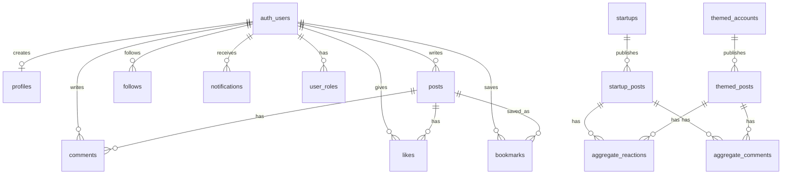

# Galaxy Ground Step 1 Architecture Audit

This audit is based on the current Vite + React project in:

`C:\Users\saisu\OneDrive\Pictures\course\galaxy-ground-space-hub-main(2)\galaxy-ground-space-hub-main(d2)`

The project is a Vite React app, not a Next.js app. Routing is handled by `react-router-dom` in `src/App.tsx`.

## 1. Current Architecture Overview

### Frontend Stack

- Vite
- React 18
- TypeScript
- React Router DOM
- TanStack Query
- Supabase JS
- Tailwind CSS
- shadcn/Radix UI primitives
- Framer Motion
- Sonner/toast notifications

### Routing

Routes are defined in `src/App.tsx`.

Current routes:

- `/auth`
- `/`
- `/explore`
- `/startups`
- `/communities`
- `/community/:slug`
- `/missions`
- `/launch/:slug`
- `/startup/:slug`
- `/hashtag/:tag`
- `/learning`
- `/profile`
- `/u/:userId`
- `/creator/:handle`
- `/post/:id`
- `/bookmarks`

There is no current route for:

- `/onboarding`
- `/admin`

### Data Layer

The app uses focused hooks rather than a single API controller:

- `src/hooks/useAuth.tsx`
- `src/hooks/usePosts.ts`
- `src/hooks/useBookmarks.ts`
- `src/hooks/useTrendingHashtags.ts`
- `src/hooks/useNotifications.ts`
- `src/hooks/useSupabaseHealth.ts`
- `src/hooks/useFollow.ts`
- `src/hooks/useStartups.ts`
- `src/hooks/useCommunities.ts`
- `src/hooks/useThemed.ts`
- `src/hooks/useSidebarStats.ts`

The Supabase client is centralized in:

- `src/integrations/supabase/client.ts`

Shared safety/normalization helpers are in:

- `src/lib/safe-data.ts`
- `src/lib/feed-data.ts`
- `src/lib/post-utils.ts`
- `src/lib/profile-utils.ts`
- `src/lib/communities.ts`
- `src/lib/supabase-env.ts`

## 2. Existing User Journey

### Guest Journey

Guests can currently view public app routes such as:

- home feed
- explore
- startups
- communities
- missions
- launch detail
- startup detail
- hashtag pages
- creator pages
- post detail

Guest actions that require authentication usually show a toast or redirect to `/auth`:

- create post
- upload media
- follow
- like
- comment
- bookmark

### Authentication Journey

`src/pages/AuthPage.tsx` supports:

- email/password sign in
- email/password sign up
- username/display name metadata during signup
- profile creation through the database trigger

Current limitation:

- After login/signup, users are redirected to `/`.
- There is no redirect-back-to-previous-page flow yet.

### Feed Journey

`src/pages/HomeFeed.tsx` provides three tabs:

- For You
- Following
- Recent

The feed uses:

- `usePosts({ includeAggregated: true, mode, infinite: true, pageSize: 15 })`
- infinite scroll with `IntersectionObserver`
- realtime "new posts available" prompt
- `PostCard` rendering
- `CreatePost` composer

### Posting Journey

`src/components/CreatePost.tsx` supports:

- text posts
- image upload
- video upload
- community selection
- hashtag extraction through `extractHashtags`
- Supabase Storage bucket `post-media`

Current limitations:

- Post quality validation is basic.
- Duplicate detection is not enforced in the frontend.
- Advanced generated-content validation belongs in Edge Functions and SQL constraints.

### Profiles

Profile pages exist:

- own profile: `src/pages/ProfilePage.tsx`
- user profile: `src/pages/UserProfilePage.tsx`
- creator/themed profile: `src/pages/ThemedAccountPage.tsx`

### Communities

Community routes exist:

- `src/pages/CommunitiesPage.tsx`
- `src/pages/CommunityDetailPage.tsx`

Community metadata is local in:

- `src/lib/communities.ts`

### Hashtags

Hashtag pages exist:

- `src/pages/HashtagPage.tsx`

Trending counts are handled by:

- `src/hooks/useTrendingHashtags.ts`
- `src/components/layout/RightSidebar.tsx`

Current limitation:

- There is no "follow hashtag" system yet.

### Notifications

Notifications exist:

- `src/hooks/useNotifications.ts`
- `src/components/NotificationsBell.tsx`

Supported behavior:

- fetch current user's notifications
- realtime refresh on inserts
- unread count
- mark all read
- mark one read

### Bookmarks

Bookmarks exist:

- `src/hooks/useBookmarks.ts`
- `src/pages/BookmarksPage.tsx`

Current bookmark behavior:

- fetch current user's bookmark IDs
- insert/delete bookmark rows
- include `post_source`
- fetch saved posts by `post_id`

### Startups and Themed Accounts

Startup pages and themed creator pages exist:

- `src/pages/StartupsPage.tsx`
- `src/pages/StartupDetailPage.tsx`
- `src/pages/ThemedAccountPage.tsx`

Automated content functions exist:

- `supabase/functions/fetch-startup-updates/index.ts`
- `supabase/functions/fetch-themed-posts/index.ts`
- `supabase/functions/_shared/contentSanitizer.ts`

## 3. Database Relationship Diagram



### Existing Tables Identified

From migrations and runtime SQL:

- `profiles`
- `user_roles`
- `posts`
- `comments`
- `likes`
- `follows`
- `startups`
- `startup_posts`
- `themed_accounts`
- `themed_posts`
- `aggregate_reactions`
- `aggregate_comments`
- `notifications`
- `bookmarks`

### Tables Not Yet Present For Requested Features

- `launches`
- `followed_hashtags` or equivalent
- onboarding-specific tracking table, unless stored entirely in `profiles`

The `profiles` table already has an `interests text[]` column, so onboarding interests can be stored there.

## 4. Missing Features

### Missing From Step 2

- `/onboarding` route.
- First-time onboarding gate.
- "Choose at least 3 interests" UI.
- Suggested follows based on interests.
- Redirect-back-to-previous-page after auth.
- Follow hashtag system.
- Dedicated hashtag follow table.
- Rich URL previews in the composer/feed.

### Missing From Step 3

- Full interest-based ranking beyond follow boosts.
- Dedicated `launches` table.
- Right sidebar launch countdown from a `launches` table.
- `/admin` route.
- Admin-only route guard using `user_roles`.
- Admin startup management.
- Admin themed account management.
- Admin controls to trigger Edge Functions.

## 5. Potential Bugs Or Technical Debt

### Auth Redirect

`AuthPage` currently navigates to `/` after signin/signup. It does not preserve the page that caused authentication.

Recommended files:

- `src/pages/AuthPage.tsx`
- components/hooks that redirect unauthenticated users

### Guest Action UX

Some guest-only blocked actions show a toast, while `CreatePost` redirects to `/auth`. This should be made consistent.

Recommended pattern:

- unauthenticated actions redirect to `/auth?redirect=<current route>` or store route in state.

### Trending Hashtag Error Handling

`useTrendingHashtags` safely handles null data, but it does not check per-query errors. If one table fails, the hook should still count the successful tables and log the failed one.

Recommended file:

- `src/hooks/useTrendingHashtags.ts`

### Reactions

`PostCard` displays emoji reactions, and `supabase/fix_remote_runtime.sql` allows both text and emoji reaction values. The aggregate reaction insert path currently does not pass `reaction_type` during insert, so Supabase default controls the stored value.

Recommended files:

- `src/components/PostCard.tsx`
- `supabase/fix_remote_runtime.sql`
- `supabase/migrations/20260529001000_fix_bookmarks_post_source_and_quality_guards.sql`

### Bookmark Source

`useBookmarks.ts` includes `post_source` and normalizes to `user`, `startup`, or `themed`. That matches the current repair SQL.

Still verify remotely:

- bookmarks table has `post_source`
- RLS policies allow authenticated select/insert/delete for own rows
- old duplicate policies are removed or idempotently recreated

Recommended files:

- `src/hooks/useBookmarks.ts`
- `supabase/fix_remote_runtime.sql`

### Post Quality

`CreatePost` only checks for empty content/file and file size. Rich generated post quality is better handled in Edge Functions, where generated content is created.

Recommended files:

- `src/components/CreatePost.tsx`
- `supabase/functions/fetch-startup-updates/index.ts`
- `supabase/functions/fetch-themed-posts/index.ts`
- `supabase/functions/_shared/contentSanitizer.ts`

### Media Rendering

`PostCard` handles image error state and lazy loading. Video rendering uses a lightweight preview and opens a lightbox, but it should include `preload="metadata"` and safe error handling if broken video URLs become common.

Recommended file:

- `src/components/PostCard.tsx`

### Missing Type Regeneration

Supabase generated types do not appear to be actively regenerated in this repo. Schema changes should be followed by type regeneration if the project uses generated database types.

## 6. Recommended Folder/File Changes

### Phase 2 Candidate Files

- `src/App.tsx`
  - add `/onboarding` route
  - eventually add `/admin` route

- `src/pages/OnboardingPage.tsx`
  - new onboarding page
  - interest selection
  - suggested follows

- `src/hooks/useOnboarding.ts`
  - determine whether user needs onboarding
  - save interests to `profiles.interests`
  - create suggested follows

- `src/pages/AuthPage.tsx`
  - support redirect-back-after-login

- `src/hooks/usePosts.ts`
  - expand For You ranking using interests and followed hashtags

- `src/hooks/useTrendingHashtags.ts`
  - add per-table error tolerance

- `src/lib/post-utils.ts`
  - add stricter hashtag validation helpers
  - add content validation helpers

### Phase 3 Candidate Files

- `src/hooks/useLaunches.ts`
  - read next launches

- `src/components/layout/RightSidebar.tsx`
  - display dedicated launch countdown widget

- `src/pages/AdminPage.tsx`
  - admin dashboard

- `src/hooks/useAdmin.ts`
  - admin role check
  - startup/themed account admin actions
  - Edge Function trigger actions

- `supabase/migrations/<new>_launches_and_followed_hashtags.sql`
  - `launches`
  - `followed_hashtags`
  - RLS policies

## 7. Recommended Execution Order

1. Stabilize current production behavior:
   - `useTrendingHashtags` partial failure handling
   - video media fallback
   - reaction type insert alignment
   - auth redirect consistency

2. Add onboarding:
   - route
   - interests UI
   - save interests
   - create suggested follows

3. Add followed hashtags:
   - table
   - hook
   - follow/unfollow button on hashtag pages
   - feed ranking integration

4. Add dedicated launches:
   - migration
   - hook
   - sidebar widget

5. Add admin dashboard:
   - admin route guard
   - startup management
   - themed account management
   - Edge Function trigger controls

## 8. Commands To Run

From VS Code terminal:

```bat
cd /d "C:\Users\saisu\OneDrive\Pictures\course\galaxy-ground-space-hub-main(2)\galaxy-ground-space-hub-main(d2)"
npm.cmd run build
npm.cmd run dev -- --host 127.0.0.1 --port 8081
```

If PowerShell blocks `npm`, use `npm.cmd` exactly as shown.

## 9. Website Checks After This Audit

Open:

`http://127.0.0.1:8081`

Check these routes:

- `/`
- `/profile`
- `/communities`
- `/startups`
- `/bookmarks`
- `/hashtag/space`
- one real `/post/:id`
- one real `/startup/:slug`
- one real `/creator/:handle`

In the website, verify:

- home feed loads without crashing
- For You, Following, and Recent tabs switch correctly
- infinite scroll does not cause `undefined.length`
- trending topics show counts in the right sidebar
- clicking a hashtag opens the hashtag page
- saving and unsaving a post does not show 400/403 errors
- own profile loads after login
- searched user profile loads
- comments open and submit only when logged in
- guest actions ask for sign-in instead of crashing
- images load or fail silently
- videos do not break the post card
- notifications bell opens for logged-in users

In DevTools Console and Network, watch for:

- `Cannot read properties of undefined (reading 'length')`
- Supabase `400`
- Supabase `403`
- missing `post_source`
- `aggregate_reactions_reaction_type_check`
- broken media errors causing React crashes

## 10. What Changed In This Step

No runtime code was changed in this step.

Created:

- `STEP_1_ARCHITECTURE_AUDIT.md`

This satisfies Step 1 of the attached execution prompt: project analysis and architecture audit before implementation.
